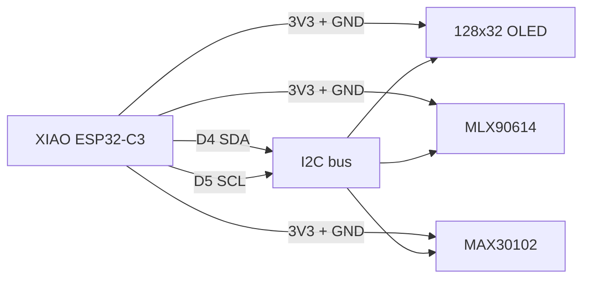

# 温度监测智能杯垫复刻包

这个目录把原项目的打印件和电子部分整理成一套可落地的复刻资料。当前 `3d文件` 目录里已经有原项目发布的主体、底板、传感器支架和铝板切割文件；这里新增了可编译固件、BOM 和接线/装配说明。

## 复刻目标

这个设备不是接触式水温计，而是一个带显示屏的红外测温杯垫：

- 杯子放在铝板上。
- `MLX90614` 从底部开孔朝上看杯底或铝板附近的目标表面。
- `MAX30102` 通过手指接触读取心率和血氧估算值。
- `Seeed Studio XIAO ESP32-C3` 读取温度、心率和血氧，并在 `128x32 SSD1306 I2C OLED` 上显示。
- USB 给 XIAO 供电，OLED、红外测温和 MAX30102 共用 I2C 总线。

红外测温读到的是视场里的表面温度，不等于杯内液体的真实温度。杯材质、杯底厚度、铝板导热、传感器与杯底距离都会影响读数。复刻时先把它当作“饮品冷热趋势提示器”，再用你常用杯子做标定。

## 目录

- `3d文件/mainbody.stl`：杯垫主体。
- `3d文件/BACKPLATE.stl`：底板。
- `3d文件/sensorholder.stl`：原项目传感器固定件。
- `3d文件/sensorbackplate.stl`：传感器背板。
- `3d文件/aluminumplate.dxf`：顶部铝板二维切割文件。
- `3d文件/aluminumplate_1p5mm.step`：顶部铝板 1.5 mm 三维上传文件。
- `firmware/smart_coaster/smart_coaster.ino`：Arduino 固件。
- `hardware/bom.csv`：采购清单。
- `hardware/heating_addon.md`：可选加热扩展方案。
- `hardware/heating_addon_bom.csv`：可选加热扩展采购清单。
- `hardware/tb6612_heater_design.md`：TB6612 驱动加热片方案。

## 需要准备

先按 `hardware/bom.csv` 采购。关键电子件是：

| 部件 | 规格 |
| --- | --- |
| 主控 | Seeed Studio XIAO ESP32-C3 |
| 红外测温 | GY-906 / MLX90614 I2C 模块 |
| 心率血氧 | MAX30102 I2C 模块，常见地址 `0x57` |
| 显示屏 | 0.91 英寸 `128x32` SSD1306 I2C OLED，常见地址 `0x3C` |
| 顶板 | 按 `3d文件/aluminumplate.dxf` 或 `3d文件/aluminumplate_1p5mm.step` 加工的 1.5 mm 铝板 |
| 结构件 | 打印 `3d文件` 中的 STL |

建议把电子件先在桌面接线跑通，再装进杯垫里。这样传感器方向、OLED 地址和固件上传问题不会混在机械装配里。

如果只想在原方案上增加加热演示，有两种方式：按 `hardware/heating_addon.md` 加独立 W1209 温控回路，或者按 `hardware/tb6612_heater_design.md` 用 XIAO 通过 TB6612 定时驱动普通加热片。当前主程序默认使用 TB6612 定时低功率加热，OLED 第三行会显示 `Heat demo H70/H0`。

## 接线

XIAO ESP32-C3 的 I2C 引脚是 `D4/GPIO6/SDA` 和 `D5/GPIO7/SCL`。OLED、MLX90614 与 MAX30102 并联在同一条 I2C 总线上。

| XIAO ESP32-C3 | OLED | MLX90614 | MAX30102 | 说明 |
| --- | --- | --- | --- | --- |
| `3V3` | `VCC` | `VIN/VCC` | `VIN/VCC` | 优先让整条 I2C 总线跑 3.3 V |
| `GND` | `GND` | `GND` | `GND` | 必须共地 |
| `D4 / GPIO6 / SDA` | `SDA` | `SDA` | `SDA` | I2C 数据 |
| `D5 / GPIO7 / SCL` | `SCL` | `SCL` | `SCL` | I2C 时钟 |

MAX30102 的 `INT` 脚不接。OLED 常见地址是 `0x3C`，MLX90614 常见地址是 `0x5A`，MAX30102 常见地址是 `0x57`。有些 GY-906 或 MAX30102 模块把电源脚写成 `VIN`，并宣称可接 5 V。这里仍建议接 XIAO 的 `3V3`，避免 I2C 上拉电平与 XIAO 的 3.3 V 逻辑打架。

## 固件上传

1. 在 Arduino IDE 安装 ESP32 板支持。
2. 在库管理器安装 `Adafruit MLX90614 Library`、`Adafruit SSD1306` 和 `Adafruit GFX Library`。MAX30102 由主程序直接通过 I2C 寄存器读取，不需要额外库。
3. 打开 `firmware/smart_coaster/smart_coaster.ino`。
4. 选择 `Seeed XIAO ESP32C3` 对应板卡和串口后上传。

固件默认使用：

- OLED 尺寸 `128x32`。
- OLED 地址 `0x3C`。
- OLED 显示方向已旋转 `180` 度，适配当前杯垫安装方向。
- 摄氏度显示。
- MAX30102 地址 `0x57`。
- 目标温度状态阈值：低于 `35 C` 显示 `COOL`，`35 C` 到 `60 C` 显示 `WARM`，高于 `60 C` 显示 `HOT`。

这些值都在 `.ino` 顶部，换显示屏地址或换提示温度时直接改常量即可。

## 装配顺序

1. 打印主体和底板。传感器件以 `sensorholder.stl` 与 `sensorbackplate.stl` 为主。
2. 按 DXF 切割 1.5 mm 铝板。先试装铝板与主体，确认边缘不卡。
3. 先把 MLX90614 固定在传感器支架里，感应窗口朝向杯垫上方开孔。
4. 把 OLED 放到主体侧面的显示窗位置，确认屏幕不会被边框遮住。
5. 把 XIAO 放到底部腔体，预留 USB 线出口。
6. 走线后再焊接或固定，避免底板合上时压到焊点和排线。
7. 合上底板前上电测试：OLED 应先显示启动页，再刷新目标温度、环境温度、心率和血氧。
8. 装上铝板，放入常用杯子做温度对照测试。

## 首次调试

### 屏幕不亮

- 先检查 `3V3`、`GND`、`SDA`、`SCL` 没接反。
- 常见 OLED 地址是 `0x3C`，少数板子是 `0x3D`。地址不同就改固件里的 `kOledI2cAddress`。
- 确认买的是 I2C OLED，不是 SPI 版本。

### 显示 `SENSOR ERROR`

- 检查 MLX90614 模块的供电与 I2C 线。
- OLED 能亮不代表传感器一定连上；两者只是共用总线。
- 如果模块焊点较松，先用短线在桌面验证后再装回结构件。

### 显示 `MAX30102 ERR`

- 检查 MAX30102 的 `3V3`、`GND`、`SDA`、`SCL`。
- 运行 `firmware/oled_i2c_test/oled_i2c_test.ino` 做 I2C 扫描，正常应能看到 `0x57`。
- MAX30102 需要手指稳定贴住传感器窗口，轻压并保持 8-15 秒后才会有较稳定读数。
- 如果心率明显乱跳，打开串口监视器看 `IR` 和 `Amp`：放手指时 `IR` 应明显高于无手指状态，`Amp` 太小说明贴合、压力或遮光不够。
- 心率和血氧读数只适合演示，不可作为医疗判断。

### 温度看起来偏差大

- 确认传感器窗口没有被打印件边缘、胶水或线材遮挡。
- 固定常用杯型、杯底位置和传感器距离再比较。
- 用一杯温度已知的热水和一杯室温水做两点参考。需要“趋势提示”时调状态阈值；需要“接近液温”时应记录杯底读数与真实液温的偏差，不要只改一个显示偏移蒙混过去。

## 原项目参考

复刻依据来自原作者的项目页与细节页：

- [Instructables: Temperature Monitoring Smart Coaster](https://www.instructables.com/Temperature-Monitoring-Smart-Coaster/)
- [Hackaday project details](https://hackaday.io/project/195185-temperature-monitoring-smart-coaster/details)
